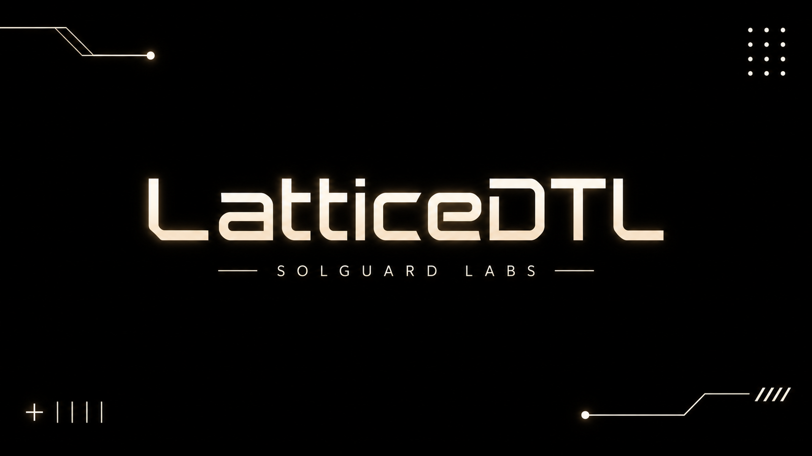
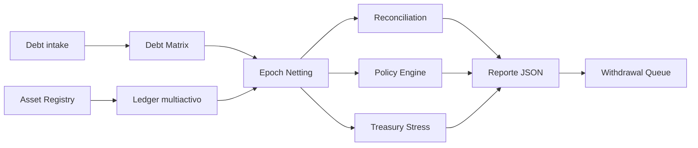
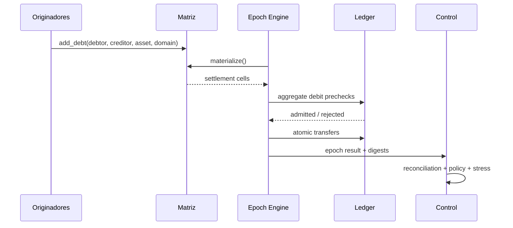
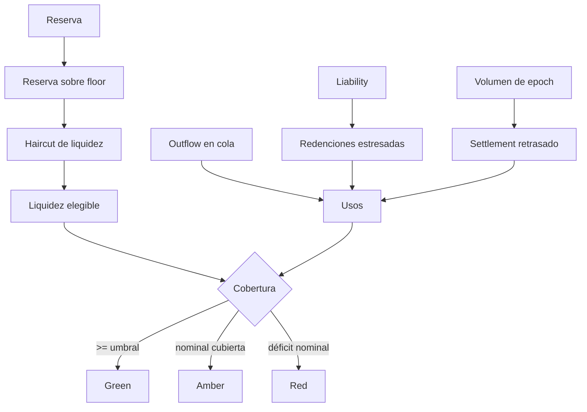

# LatticeDTL



LatticeDTL es un motor C11 de netting y liquidación multiactivo. Consolida
obligaciones bilaterales, ejecuta cierres de época contra un ledger por activo,
controla retiradas de vault y produce evidencia JSON determinista para
reconciliación, riesgo y tesorería.

## Capacidades

- Registro de activos, dominios de liquidez y lanes primarias.
- Ledger cuenta-activo con reservas, liabilities, locks y journal.
- Matriz de obligaciones con reducción exacta y compactación operativa.
- Precheck agregado de débitos antes de aplicar un epoch.
- Retiradas con límites por clase de riesgo y reserva disponible.
- Reconciliación independiente por activo.
- Stress de tesorería operativo y severo.
- CLI reproducible para integraciones y controles de regresión.
- Digests de registry, matriz, ledger, policy y stress.

## Arquitectura



La matriz no muta saldos durante la admisión. Primero materializa obligaciones,
después el cierre calcula débitos agregados por cuenta y activo, y solo entonces
aplica transferencias. Si un precheck falla, el ledger no publica un cierre
parcial.

## Cierre de época



Los importes se expresan en unidades mínimas. Para un activo de seis decimales,
`15_000_000` representa 15 unidades completas.

## Modelo de tesorería

El módulo `treasury_stress` calcula una cascada por activo:

```text
available_reserve = max(0, reserve - reserve_floor)
eligible_liquidity = available_reserve × (1 - reserve_haircut)

stressed_redemptions = liability × redemption_shock
delayed_settlement = epoch_volume × settlement_delay
uses = stressed_redemptions + delayed_settlement + queued_outflow

coverage = eligible_liquidity / uses
required_buffer = max(0, uses × minimum_coverage - eligible_liquidity)
```



Consulte [`docs/modelo-economico.md`](./docs/modelo-economico.md) para fórmulas,
redondeos y un ejemplo numérico.

## Escenarios CLI

```bash
npm ci
npm run build
./build/lattice-dtl baseline
```

En Windows el binario se genera como `build/lattice-dtl.exe`.

| Escenario    | Propósito                          |
| ------------ | ---------------------------------- |
| `baseline`   | Netting multiactivo de referencia  |
| `compact`    | Microposiciones de un mismo activo |
| `domains`    | Lanes grandes por dominio y activo |
| `withdrawal` | Retirada directa desde vault       |
| `batch`      | Epoch mixto y retirada posterior   |
| `snapshot`   | Metadata determinista inicial      |
| `policy`     | Precheck de límites por cuenta     |
| `stress`     | Escenario severo de tesorería      |

Listar ayuda:

```bash
./build/lattice-dtl --help
```

## Salida JSON

Cada ejecución incluye:

- protocolo, escenario y resultado global;
- activos, cuentas, balances y vaults;
- reconciliación por activo;
- policy por cuenta y último precheck;
- stress de tesorería por activo y agregado;
- estadísticas de matriz y cierre de epoch;
- retiradas y digests deterministas.

Ejemplo Node.js:

```javascript
import { execFileSync } from "node:child_process";

const raw = execFileSync("./build/lattice-dtl", ["stress"], {
    encoding: "utf8",
});
const report = JSON.parse(raw);

if (!report.conservation || !report.reconciliation.ok) {
    throw new Error("economic reconciliation failed");
}
```

## Verificación

```bash
npm ci
npm run ci
```

La suite compila con warnings como error, valida sintaxis JavaScript, ejecuta
14 contratos de escenario, inspecciona la superficie pública y comprueba los
artefactos de release. GitHub Actions repite el proceso en Linux y Windows.

Build directo con Make:

```bash
make
make test
```

## Documentación

- [Arquitectura y límites](./docs/architecture.md)
- [Modelo económico](./docs/modelo-economico.md)
- [Riesgo y límites](./docs/riesgo.md)
- [Operación y reconciliación](./docs/operacion.md)
- [Integración del CLI](./docs/integracion.md)
- [Política de seguridad](./SECURITY.md)
- [Contribución](./CONTRIBUTING.md)
- [Historial de cambios](./CHANGELOG.md)

## Estructura

```text
src/                 Dominio C11, runtime y serialización
tests/node/          Contratos de negocio contra la CLI
tests/helpers/       Build compartido y utilidades
docs/                Arquitectura, economía, riesgo y runbooks
scripts/             Build portable y validaciones
.github/workflows/   CI e integridad de release
```

## Compatibilidad

- C11 con GCC, Clang o MSVC.
- Node.js 24 o superior.
- Linux y Windows.

La versión estable es `v1.0.0` y se publica desde la rama `production`.
