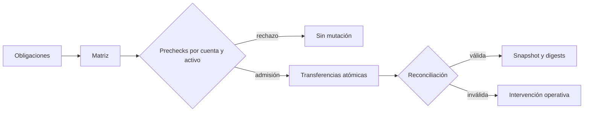
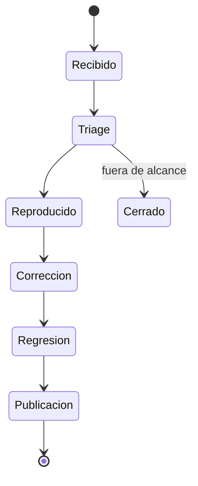

# Política de seguridad

## Versiones mantenidas

| Versión | Estado      |
| ------- | ----------- |
| 1.0.x   | Mantenida   |
| < 1.0   | Sin soporte |

## Modelo de confianza

LatticeDTL trata el registry, el ledger y la matriz como fronteras distintas.
Las deudas admitidas no son saldos hasta que un cierre de epoch supera todos
los prechecks. Las retiradas operan después del cierre sobre balance, reserve y
liability reconciliados.

## Invariantes

- La suma de balances por activo coincide con su liability.
- Reserve y liability nunca son negativos.
- La reserva se mantiene por encima del floor configurado.
- Una cuenta no puede transferir más balance disponible del activo.
- Las celdas materializadas conservan IDs, dominio, importe y dirección.
- Los prechecks se completan antes de la primera transferencia del epoch.
- Una retirada reduce balance, reserve y liability por el mismo importe.
- Los digests cambian ante una mutación económica.
- El stress usa redondeo conservador en usos y buffers.

## Controles automatizados

| Control                                      | Evidencia                                      |
| -------------------------------------------- | ---------------------------------------------- |
| C11 `-Wall -Wextra -Werror` o MSVC `/W4 /WX` | Build portable                                 |
| Contratos Node                               | Flujos de netting, policy, retirada y stress   |
| Reconciliation                               | Conservación y floors por activo               |
| Public surface                               | Ausencia de material interno en la publicación |
| Release integrity                            | Versionado, banner y documentos obligatorios   |
| Dependabot                                   | npm y GitHub Actions                           |

## Áreas prioritarias

1. Claves económicas usadas al reducir filas de matriz.
2. Separación de activos y dominios durante materialización.
3. Agregación de débitos previa al settlement.
4. Orden de cambios de balance, reserve y liability.
5. Redondeos en pesos de riesgo, haircuts y cobertura.
6. Límites por cuenta de sistema y participantes.
7. Determinismo de la serialización y los digests.

## Reporte responsable

No publique detalles sensibles en issues. Abra un advisory privado desde la
pestaña **Security** del repositorio e incluya:

- versión o commit evaluado;
- estado inicial y secuencia mínima;
- activos, cuentas, dominio y época implicados;
- salida JSON relevante;
- impacto económico cuantificado por activo;
- propuesta de mitigación y regresión.

No incluya credenciales, claves, secretos ni información personal.

## Respuesta

La recepción no implica confirmación del impacto. La publicación se realiza
cuando existe una corrección verificada y una versión mantenida disponible.

## Fuera de alcance

- Ingeniería social o suplantación.
- Ataques de disponibilidad sin impacto económico reproducible.
- Alteraciones manuales del binario o del estado fuera de las APIs.
- Problemas de un compilador no soportado.
- Reportes de dependencias sin una ruta alcanzable en LatticeDTL.
