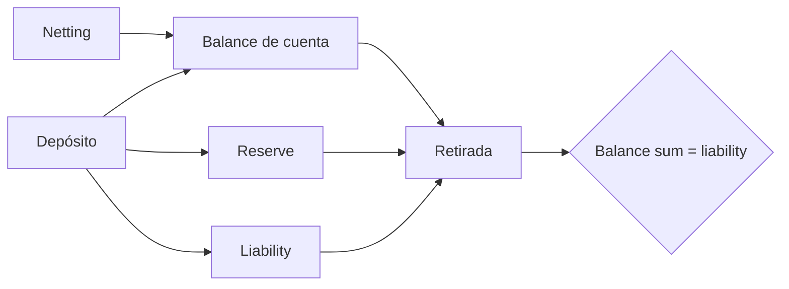

# Modelo económico

## Unidades y activos

Cada activo declara precisión, dominio, peso de riesgo, floor de reserva y
capacidad de retirada. Los importes usan `int64_t` y nunca coma flotante. Un
activo con seis decimales representa una unidad como `1_000_000`.

## Contabilidad del vault

```text
reserve   = activos disponibles bajo custodia lógica
liability = suma de balances reconocidos para el activo
gap       = reserve - liability
```

Un depósito incrementa reserve, liability y balance. Un settlement interno
solo mueve balances. Una retirada reduce las tres magnitudes económicas por el
mismo importe.



## Netting

Cada obligación contiene deudor, acreedor, activo, dominio, importe y
prioridad. El cierre reduce filas compatibles y materializa celdas dirigidas.
Antes de transferir, agrega débitos por cuenta-activo y consulta el ledger.

Para una pareja bilateral dentro de la misma dimensión económica:

```text
signed_amount = debt(low -> high) - debt(high -> low)
```

El signo determina la dirección materializada y el valor absoluto, el importe.

## Stress de tesorería

El escenario operativo usa:

| Parámetro            | Valor |
| -------------------- | ----: |
| Redenciones          |   8 % |
| Settlement retrasado |  10 % |
| Haircut de reserva   |   5 % |
| Cobertura mínima     | 105 % |

El severo usa 25 %, 35 %, 20 % y 115 %, respectivamente.

```text
available = max(0, reserve - floor)
eligible  = floor(available × (1 - haircut))

redemptions = ceil(liability × redemption_bps)
delay       = ceil(epoch_volume × delay_bps)
uses        = redemptions + delay + queued_outflow

coverage = eligible / uses
buffer   = max(0, ceil(uses × minimum_coverage) - eligible)
```

Los recursos se redondean a la baja. Los usos y el buffer se redondean al alza.

## Semáforo

- `green`: cobertura igual o superior al mínimo.
- `amber`: cubre usos nominales, pero no el buffer objetivo.
- `red`: existe déficit nominal.

El nivel agregado es el peor nivel de sus activos. También se publican sumas de
liquidez elegible, usos, shortfall y buffer para planificación de tesorería.
