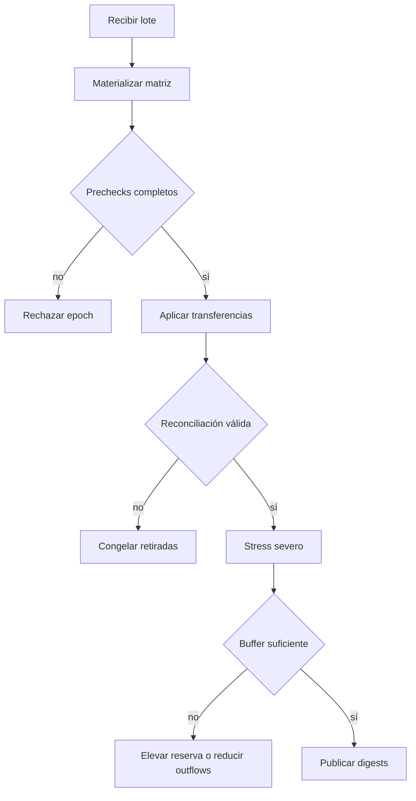

# Operación y reconciliación

## Arranque

```bash
npm ci
npm run build
./build/lattice-dtl snapshot
```

La CLI no necesita red ni variables de entorno. Devuelve un documento JSON por
stdout y errores por stderr con código distinto de cero.

## Señales

| Señal                           | Uso                                      |
| ------------------------------- | ---------------------------------------- |
| `registryDigest`                | Identidad del catálogo de activos        |
| `matrix.digest`                 | Identidad de obligaciones materializadas |
| `ledgerDigest`                  | Identidad del estado económico final     |
| `reconciliation.ok`             | Conservación por activo                  |
| `policy.flaggedAccounts`        | Cuentas fuera de límite                  |
| `treasuryStress.level`          | Peor estado de liquidez                  |
| `treasuryStress.requiredBuffer` | Refuerzo total requerido                 |

## Runbook de cierre



## Diagnóstico

1. Conservar commit, escenario y JSON completo.
2. Comparar los tres digests con el último cierre aceptado.
3. Localizar el primer activo con `reconciliation.ok=false`.
4. Comparar volumen de epoch, redenciones y outflows en cola.
5. Ejecutar `snapshot`, `baseline` y `stress` desde un estado nuevo.
6. No reutilizar un runtime después de un fallo de precheck.

## Release

Una publicación estable exige el mismo commit en `main`, `production` y el tag
anotado. CI debe pasar en Linux y Windows; el evento de release debe completar
el job de integridad.
