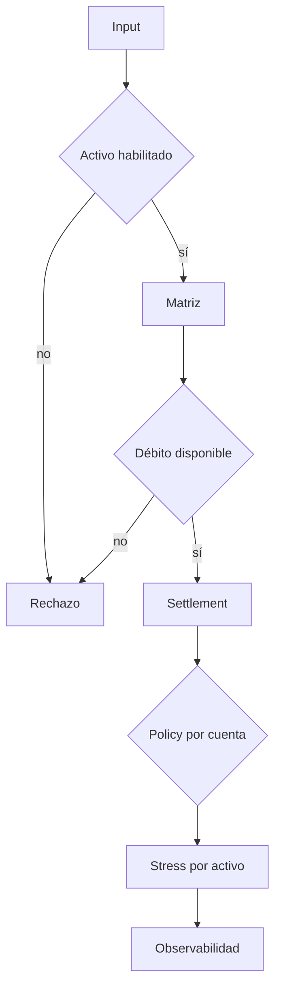

# Riesgo y límites

## Capas de control

LatticeDTL aplica controles en cuatro momentos:

1. registro de activos y cuentas;
2. admisión de obligaciones;
3. precheck agregado de settlement;
4. retirada y stress posterior al cierre.



## Clases de cuenta

Cada clase define exposición máxima, retirada máxima, peso de activo admitido y
si una cuenta de sistema puede usar una excepción explícita. El reporte publica
exposición ponderada, activos activos y estado del límite.

## Peso de riesgo

```text
risk_units = balance × asset_risk_weight_bps / 10_000
account_exposure = sum(risk_units)
```

La operación usa enteros y redondeo hacia abajo. Un límite de retirada se
evalúa además contra el balance, el flag del activo y la reserva del vault.

## Concentración y liquidez

La reconciliación responde si el libro conserva por activo. El stress responde
si el activo conserva capacidad líquida bajo shocks. Ambos controles son
necesarios: un libro puede estar balanceado y aun así requerir buffer.

## Cambios de parámetros

Un cambio de floor, haircut, redención o delay debe incluir:

- snapshot y digest de registry;
- comparación operativo/severo;
- buffer incremental por activo;
- efecto sobre cuentas dentro de policy;
- prueba de extremos 0 %, 100 % y máximo de cobertura permitido.
